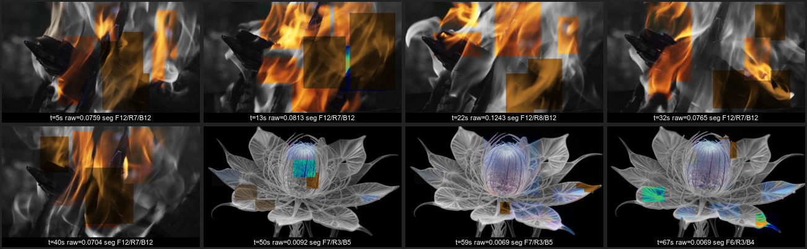
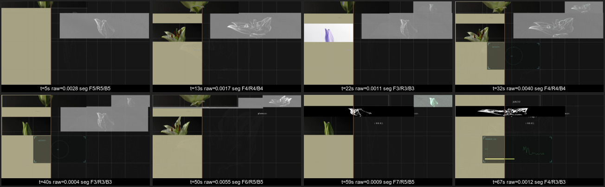
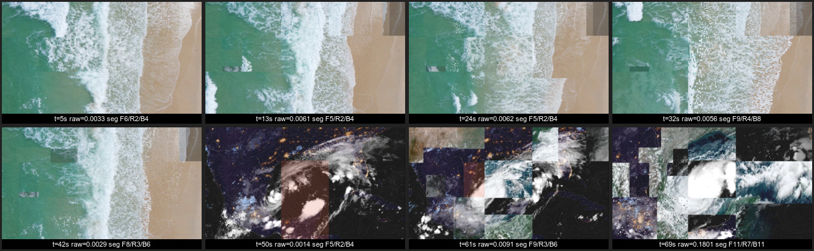
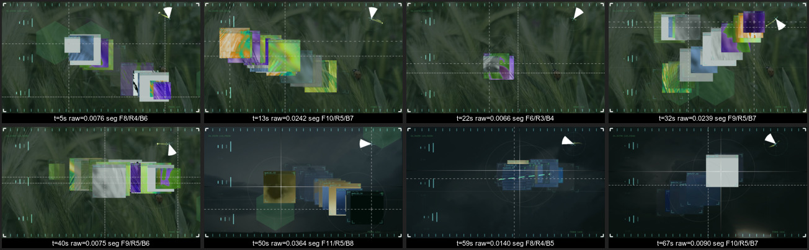
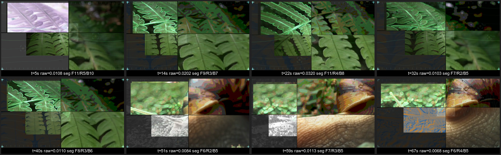
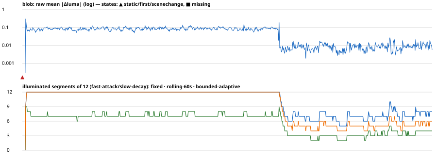

# OC-004 — Scene Visual Activity Measurement Probe: Investigation Report

**Owner:** ExperienceRuntime · **Date:** 2026-11-04 · **Platform measured:** macOS desktop (GL 3.2 core). **Pi: not tested** (no unsupervised Pi testing).
**Status:** diagnostic probe built and run; desktop gaps (GPU timer, uncapped/combined perf, long-run calibration, Quadrant ranking) closed in the follow-up pass (marked **[follow-up]**). No production HUD change, no HUD-004/006 change, `scene.activity.overall` untouched.

> **Recommendation (short): PASS, with conditions, for the *measurement* on desktop. NOT PASSED for Raspberry Pi — unmeasured.** Details in §8.

Evidence lives in [`oc-004-evidence/`](oc-004-evidence/) (timelines, contact sheets, CSVs, analysis scripts).

---

## 1. Actual sampling implementation and source

### What exists today (Phase 1 findings)

| Piece | Finding |
|---|---|
| SceneFBO | `ExperienceRuntime::sceneFbo_`, 8-bit RGBA, display-encoded sRGB, cleared to (0,0,0,0). Rendered in `draw()`; live frames only (`activeSceneLiveThisFrame()`); during transitions a *retained* frame sits in it. |
| `SceneColorSampler` | Halving/GPU reduction SceneFBO → 160×90 RGBA16F (linear light) → 16×9, readback `Sync` / `Async` (PBO+fence) / `Deferred` (2 frames later, two ping-pong 16×9 targets). 2 Hz, 120-sample ring, generation-scoped, gaps for static frames. GLES2 falls back to an 8-bit CPU-linearised chain. |
| Publication | `SnapshotPublisher` → immutable `scenecolor::SceneColorSnapshot` in `HudFrameData::sceneColor` (shared_ptr, rebuilt only on revision change). |
| `scene.activity.overall` | A *scene-semantic* `std::optional<float>` in `SceneSemanticState::activity`, filled by each scene's own semantic mapping and resolved in `HudRealFrameResolver.cpp`. Unrelated to pixels. **Not touched.** |
| Generation / transitions | `sceneColorGeneration_` bumps on every `activationSucceededThisFrame()`; static transition frames call `onStaticFrame()`. The probe reuses exactly these hook points. |

**Smallest implementation that reuses existing resources:** the existing 160×90 target (`linA_`) is private to `SceneColorSampler` and 160×90 → 64×36 is a non-integer 2.5× ratio, so reusing it would have required modifying the ratified sampler. Instead the probe is a self-contained class that **reuses the pattern** (same hook points, same generation id, same `StageStat`, same reduction-shader approach) with its own ~150 KB of targets. `SceneColorSampler` and the snapshot are unmodified.

### Source (all new files are opt-in and inert unless `EXPERIENCE_RUNTIME_SCENE_ACTIVITY_PROBE=<dir>`)

| File | Role |
|---|---|
| `sketches/experience_runtime/src/SceneActivityCore.h` | OpenFrameworks-free core: states, `meanAbsDiff`, three normalisers, rolling max, fast-attack/slow-decay smoother, segment mapping. |
| `sketches/experience_runtime/src/SceneActivityProbe.h/.cpp` | GL half: luminance reduction, CPU- and GPU-side difference, readback, CSV logging. |
| `sketches/experience_runtime/test/scene_activity_core_tests.cpp` | Bare-compiler unit tests of the core (pass). |
| `ExperienceRuntime.h` (+2 lines), `ExperienceRuntime.cpp` (+4 call lines) | Member `sceneActivityProbe_`; `beginGeneration`, `onLiveFrame`, `onStaticFrame`, `poll`. |

### Measurement definition

1. **Source:** SceneFBO after the scene pass, before HUD composition.
2. **Reduction (GPU, pass 1):** box mean to **64×36**, each cell sampled at texel centres with ≤16×16 taps (strided when the block is larger). Per texel: `e = rgb·alpha` (composited over black), then two channels — `enc = dot(Rec.709, e)` (luma of the *displayed* values, used as the raw signal) and `lin = dot(Rec.709, EOTF(e))` (relative luminance, logged for comparison). RGBA32F targets.
3. **Difference:** *raw* = mean over the 2304 cells of |grid_n − grid_{n−1}|, 0..1.
   - **CPU path:** read the 64×36 grid back (36.9 KB), difference on CPU.
   - **GPU path:** `|A−B|` and block-mean 64×36 → 8×6 → 1×1 on the GPU, read back **one texel**.
   - **`verify` mode** runs both on the same pair: max |GPU−CPU| over all runs = **1.1e-7** (float rounding). They are equivalent.
4. **Cadence:** nominal 10 Hz; effective 9.2–10.0 Hz measured.
5. **Explicit state handling** (every event is a CSV row with a `state`):

| State | Meaning | Raw? |
|---|---|---|
| `valid` | difference vs. previous grid, one period apart | yes |
| `wide` | valid, but gap > 1.5 periods (stall / late frame); `dt` recorded | yes |
| `first` | first grid of a generation or after a static run; nothing to diff | no |
| `static` | transition retained frame; **no measurement exists** (never a zero) | no |
| `scenechange` | generation boundary; history, rolling window and smoother reset | no |
| `missing` | live scene but no sample for > 3 periods | no |
| `unsupported` | format/GL path not measurable (also GLES) | no |

   Differences never cross a scene change or a static run. A deferred read is dropped if the generation changed in flight.
6. **Raw is preserved independently:** `rawEnc`/`rawLin` are logged before any normalisation; normalised levels, smoothed levels and segment counts are separate columns. The Python mirror of the normalisers reproduces the C++ columns to ≤6.5e-5, so strategies can be re-run offline on the raw series.

---

## 2. Normalisation strategies

All three use `level = clamp((raw/ref)^γ, 0, 1)`, differing in `ref`. Defaults were *starting values*; §2.3 re-derives the fixed mapping from real data.

### 2.1 Real-data behaviour (five scenes, 75 s each, smoothed output, 12 segments)

| Scene | raw p05 / p50 / p95 / max | Fixed (ref 0.04) mean seg · at 12 | Rolling-60 s mean seg · at 12 | Bounded (0.5–2×) mean seg · at 12 |
|---|---|---|---|---|
| Blob | 0.0048 / 0.075 / 0.107 / 0.310 | 10.2 · **63 %** | 5.7 · 0 % | 9.5 · **63 %** |
| Temporal | 0.0025 / 0.0063 / 0.025 / 0.518 | 7.2 · 1 % | 2.7 · 0 % | 5.5 · 0 % |
| Blueprint | 0.0006 / 0.0019 / 0.0073 / 0.078 | 4.5 · 0 % | 4.0 · 0 % | 4.0 · 0 % |
| Fragment | 0.0043 / 0.0104 / 0.025 / 0.194 | 8.3 · 1 % | 4.4 · 0 % | 6.1 · 0 % |
| Quadrant | 0.0058 / 0.0123 / 0.049 / 0.227 | 8.5 · 8 % | 3.8 · 0 % | 6.7 · 3 % |

Observations:
* **No real scene produced raw = 0** (ambient animation/video everywhere). "Stillness" in practice is raw ≈ 0.0006–0.002 (Blueprint). The meter never needs to show exactly 0 for a live scene.
* Blob's raw is bimodal (fire video ≈ 0.075–0.12 vs. lotus video ≈ 0.007): the probe sees the video change (see §3).
* Raw spans ~3 decades (0.0005 → 0.3), so a linear map would be unusable; a compressive curve is required.

### 2.2 Behaviour by regime

Real-data regimes are from the table above. The synthetic stress sequence (stillness 1e-4, subtle 0.004, continuous 0.02, rapid 0.08, flash 0.4, cut 0.35; steady-state smoothed level) is **behavioural only — no threshold was chosen from it**:

| Regime | Fixed | Rolling 60 s | Bounded |
|---|---|---|---|
| Stillness | 0.05 (1 seg) | 0.22 (3 segs) — floor-limited self-amplification | 0.07 (1 seg) |
| Subtle | 0.32 | **1.0** — a quiet scene fills the meter | 0.45 |
| Continuous / rapid | 0.71 / 1.0 | 1.0 / 1.0 — no contrast between them | 1.0 / 1.0 |
| Still *after* a flash | 0.05 | **0.016** — suppressed ~60 s | 0.04 |
| Subtle after a cut | 0.32 | **0.10** — suppressed ~60 s | 0.22 |

* **Rolling max** destroys cross-scene and cross-regime meaning (continuous = rapid = full) and one outlier mutes it for 60 s. Real data has such outliers (Temporal max 0.518 vs p95 0.025 — video loop cuts). It also restarts empty at every scene change.
* **Bounded adaptive** limits the damage to ≤2× but inherits the same outlier sensitivity and keeps a moving reference that the HUD cannot explain to a viewer.
* **Fixed** is stable, comparable across scenes and explainable, but the default `ref 0.04` saturates Blob.

### 2.3 Fixed mapping calibrated on the real data (recommended)

Pooled real raw (all five scenes) compared across curves (segments p10/p50/p90, share of time at 12):

| Curve | Blob | Temporal | Blueprint | Fragment | Quadrant |
|---|---|---|---|---|---|
| sqrt, ref 0.04 (probe default) | 5/12/12 · 63 % | 4/5/8 | 2/3/5 | 5/7/9 | 5/7/10 |
| sqrt, ref 0.20 | 3/8/9 | 2/3/4 | 1/2/2 (37 % ≤1) | 2/3/4 | 3/3/5 |
| **log, 5e-4 … 0.30** | **5/10/10 · 0 %** | 4/5/7 | 1/3/5 | 5/6/8 | 5/7/8 |

`level = log10(raw/5e-4) / log10(0.30/5e-4)`, clamped. No saturation, scenes remain distinguishable (fire ≈ 10, lotus/Blueprint ≈ 3). **[follow-up] Re-check on 4-minute captures per scene** (`csv_long/`, ~235 s each; 494–2378 valid samples). The 75 s window was not representative for Blob: its 4-minute median is **0.016** (the 75 s window happened to be the fire video, p50 0.075), and the max is a hard cut at 0.96. Other scenes were consistent (Blueprint p50 0.002, Temporal 0.010, Fragment 0.009, Quadrant 0.017).

| Curve (segments p10/p50/p90 · share at 12 · share ≤ 1) | Blob | Temporal | Blueprint | Fragment | Quadrant |
|---|---|---|---|---|---|
| sqrt, ref 0.04 (probe default) | 5/8/11 · 9 % | 4/6/12 · 12 % | 2/3/5 | 5/6/9 | 6/8/12 · **21 %** |
| log 5e-4…0.30 | 5/7/8 · 1 % | 4/6/9 · 0 % | 2/3/5 · **7.5 % ≤ 1** | 5/6/7 | 6/7/9 |
| **log 3e-4…0.30 (recommended)** | 6/7/9 · 1 % | 4/7/9 · 0 % | 3/4/5 · 1.2 % ≤ 1 | 5/6/8 | 6/8/9 · 0 % |

The default sqrt curve saturates Quadrant 21 % and Temporal 12 % of the time on longer data. The log mapping with floor **3e-4** and ceiling **0.30** keeps every scene off both rails (≤ 1 % at 12 segments, ≤ 1.2 % at ≤ 1) and still separates scenes. **Recommended provisional constants: floor 3e-4, ceiling 0.30** (changed from the first-pass 5e-4). Still one session of ~4 min per scene on today's media pool; re-check when media changes.

### 2.4 Fast-attack / slow-decay smoothing (τ_attack 0.08 s, τ_decay 0.9 s)

* Segment changes per second, raw → smoothed: Blob 2.5→0.75, Temporal 5.3→2.6, Blueprint 4.4→1.8, Fragment 7.5→2.7, Quadrant 6.7→2.0 (≈ 60–70 % less flicker).
* Attack is within one sample (a 0.35 cut lights 9 segments on the next sample); decay from full to a quarter takes ≈ 1.25 s.
* Non-measurement events (static/missing) feed 0 into the smoother, so a stale bar decays rather than sticks. The HUD should still show *missing* distinctly (§6).

---

## 3. Five-scene visual evidence

Per scene: [`timeline_<scene>.svg`](oc-004-evidence/) (raw on a log axis with state markers + the three segment traces) and [`sheet_<scene>.jpg`](oc-004-evidence/) (8 actual SceneFBO frames with timestamp, raw value and illuminated segments F/R/B = fixed/rolling/bounded). Raw rows: `oc-004-evidence/csv/five_scene_*.csv`.









Visible tracking, e.g. Blob: fire frames (t = 5–40 s) raw 0.070–0.124 → fixed 12/12; lotus frames (t = 50–67 s) raw 0.007–0.009 → fixed 6–7. Blueprint's near-static grid frames sit at raw 0.0004–0.0055.

### Independent ground truth

Every sample's full-resolution SceneFBO frame was dumped (22 s/scene, ~185 consecutive pairs) and differenced offline with ffmpeg (full-res, BT.601 gray, 8-bit). `ground_truth.json`:

| Scene | pairs | Pearson | Spearman | probe/full-res (median) |
|---|---|---|---|---|
| Blob | 189 | 0.98 | 0.97 | 0.49 |
| Temporal | 167 | 0.99 | 0.95 | 0.29 |
| Blueprint | 181 | 0.86 | 0.85 | 0.23 |
| Fragment | 184 | 0.94 | 0.92 | 0.45 |
| Quadrant | 185 | 0.89 | **0.53** | 0.47 |

The probe tracks visible change in all five scenes (Pearson 0.86–0.99). It reads **2–4× lower** than the full-res difference: 20×20-pixel box averaging removes fine-grain/dither/shimmer (Blueprint's full-res difference never drops below 0.025 while the probe goes to 0.0006), which is arguably desirable for "visible change" but means the probe is **blind to sub-cell detail**. **[follow-up] Quadrant's weak rank (Spearman 0.53) explained.** Re-scoring the same frames against a 320×180 reference (`alt.py`) gives Quadrant Pearson 0.99 / Spearman **0.95** for the 64×36 mean. So the probe orders Quadrant's changes correctly at ≥ 5×5-pixel scale; the disagreement with the full-resolution (1280×720) reference comes from sub-5-pixel detail (fine overlay/line shimmer) that the 64×36 mean intentionally averages away. Whether that detail counts as "visible activity" is a product decision, not a probe defect.

Same frames, other designs (Pearson/Spearman vs. the 320×180 reference):

| Grid · statistic | Quadrant | Blueprint | Fragment | Temporal | Blob |
|---|---|---|---|---|---|
| **64×36 · mean abs diff (current)** | 0.99/0.95 | 0.90/0.86 | 0.96/0.95 | 1.00/0.97 | 0.99/0.99 |
| 128×72 · mean abs diff | 1.00/0.96 | **0.98/0.96** | 0.98/0.97 | 1.00/0.99 | 1.00/1.00 |
| 32×18 · mean abs diff | 0.98/0.93 | 0.72/0.74 | 0.92/0.91 | 0.99/0.93 | 0.98/0.97 |
| 64×36 · RMS | 0.97/0.90 | 0.74/0.72 | 0.83/0.86 | 1.00/0.92 | 0.96/0.92 |

Mean absolute difference beats RMS everywhere (keep it). 32×18 and below degrade Blueprint badly. **128×72 improves the line-art scene (Blueprint Spearman 0.86 → 0.96)** at 4× the grid (≈ 295 KB RGBA32F; with the GPU diff path the readback stays 16 B). Not adopted — 64×36 was the brief — but it is the cheapest accuracy upgrade if Blueprint-like scenes matter.

### Transitions, missing and stale (full-ring harness, 150 s)

32 generations, 100 `static` rows, **every generation began with `first`** (no difference across a scene change), 2 `missing` rows. Median max raw within 0.6 s after a scene change was 0.06 (max 0.21) — that is real content, not a cross-scene spike. An earlier run whose PNG encoding stalled the render loop produced 34 `missing` rows (`csv/stale_demo_png_stalls_temporal.csv`), confirming stale detection fires.

---

## 4. Desktop performance

Setup: macOS, Temporal scene, 30 fps (the runtime's cap), 60 s per config, first 10 s dropped, probe **without** frame dumps. `frames.csv` = per-frame deltas. **Only the isolated runs listed below are trusted** (see caveats).

| Config | frame dt p50 / p95 / p99 / max (ms) | probe CPU per active frame p50 / p95 (ms) | stage total p50 / p95 (ms) | cadence |
|---|---|---|---|---|
| Baseline (probe off, color off) | 33.34 / 34.13 / 34.71 / 75.3 | – | – | – |
| Existing color sampler, **sync** (default) | 33.32 / 37.67 / **40.90** / 81.0 | – | 6.13 / 7.68 (wait 6.09) | 2 Hz |
| Existing color sampler, deferred | 33.33 / 34.13 / 35.26 / 83.7 | – | 0.19 / 0.34 | 2 Hz |
| **Probe CPU diff, deferred** | 33.31 / 35.07 / 36.74 / 155.7 | 0.167 / 0.432 | 0.36 / 0.47 | 9.9 Hz |
| Probe CPU diff, sync | 33.33 / 36.94 / 37.92 / 61.4 | 3.14 / 3.48 | 3.17 / 3.49 | 10.0 Hz |
| **Probe GPU diff, deferred** | 33.32 / 34.16 / 34.69 / 73.6 | 0.115 / 0.215 | 0.17 / 0.24 | 10.0 Hz |
| Probe GPU diff, sync | 33.32 / 38.28 / 38.72 / 78.8 | 4.52 / 4.70 | 4.51 / 4.70 | 10.0 Hz |

Stage costs (deferred CPU path): submit 0.049 ms, readback 0.23 ms (p95 0.32), CPU difference **0.019 ms**, publication none (probe publishes nothing). `diffCpu` is negligible, so the CPU-vs-GPU difference question is really a *readback size* question: 36.9 KB (CPU) vs 16 B (GPU) — both ≈ 0.1–0.25 ms when deferred.

**Findings**
* **Deferred readback makes either probe path free at 30 fps** (p99 +0.0–2 ms vs baseline). **Sync readback** adds 3–4.5 ms per sample and moves p95 by ≈ +3 ms; it behaves like the existing sync color sampler (p95 +3.5 ms) — a 10 Hz probe is 5× as often as the 2 Hz sampler, so sync would be a worse stall source.
* Compared with the existing sampler, the deferred probe costs about the same per sample, at 5× the cadence.
* The sync `wait` mostly measures draining the GPU work already queued by the scene, not the reduction itself.
* **[follow-up] GPU reduction cost, measured with `GL_TIME_ELAPSED` queries** (`..._GPU_TIMER=1`, read at sample completion so they add no stall): luma pass **0.11–0.23 ms p50, ≤ 0.27 ms max**; the GPU-diff passes (64×36 → 8×6 → 1×1) add **0.08–0.20 ms p50, ≤ 0.23 ms max**. Timer values cluster in ≈ 0.11 ms steps, so read these as ±0.1 ms. At 10 Hz that is ≈ 0.3–0.5 ms of GPU time per second. The existing 2 Hz color sampler was not timer-instrumented (it is unmodified).
* **Memory:** 2 × 64×36 + 8×6 + 1×1 RGBA32F ≈ **74 KB GPU**, plus ≈ 37 KB readback buffer and ≈ 37 KB CPU grid mirrors. Existing sampler: 160×90 RGBA16F ≈ 115 KB + 2 × 16×9. Negligible both.
* **Max-frame spikes (60–156 ms)** occur in the baseline too (75 ms: video/asset loads).
* **[follow-up] Control for scene stalls.** In the 4-minute calibration runs Fragment, Quadrant and Blueprint stalled heavily (Fragment: > 200 ms frames summing to ~165 s of 240 s; Blob: 0.5 s). A control run of Fragment with the probe **off** stalled as much or more (79.8 s of 100 s) than with the probe on (58.9 s), so the stalls belong to the scene/environment (missing `fragment-trail/backgrounds` directory, video loads, shared machine), not the probe. They inflate `wide`/`missing` rows and cut the usable sample count in those runs (Fragment: 494 valid in 235 s) — exactly what the state machine is meant to expose.

### [follow-up] Uncapped, interleaved, repeated (limiter and vsync off, 45 s × 2 repeats, machine load recorded per run)

Frame dt p50 / p95 / p99 (ms); `r1`/`r2` = repeat, (load) = 1-min load average at start (`perf_uncapped/*.load.txt`):

| Config | r1 | r2 |
|---|---|---|
| Baseline | 6.23 / 12.14 / 21.21 (11.4) | 5.44 / 7.95 / 10.98 (4.7) |
| Color sampler sync | 8.49 / 22.38 / 46.20 (16.0) | 6.20 / 8.85 / 13.62 (5.8) |
| Color sampler deferred | 5.25 / 7.77 / 10.40 (14.2) | 5.43 / 8.15 / 10.37 (6.2) |
| Probe CPU, deferred | 6.13 / 9.11 / 15.26 (11.3) | 5.62 / 7.97 / 11.62 (6.4) |
| Probe CPU, sync | 5.28 / 8.65 / 11.28 (7.9) | 5.74 / 9.18 / 12.21 (4.9) |
| Probe GPU, deferred | 6.17 / 9.75 / 13.56 (6.1) | 5.65 / 7.64 / 10.48 (4.3) |
| Probe GPU, sync | 5.88 / 9.14 / 11.98 (4.6) | 5.62 / 9.09 / 12.03 (4.5) |
| Color sync + probe CPU deferred | 6.43 / 9.12 / 13.29 (4.3) | 5.62 / 8.33 / 11.16 (4.3) |
| Color deferred + probe CPU deferred | 5.44 / 7.85 / 11.04 (5.9) | 5.70 / 8.80 / 11.38 (4.5) |

Reading it honestly: run-to-run noise (the baseline alone moves 0.8 ms p50 and 10 ms p99 between repeats, driven by machine load) is **as large as most config differences**. Deferred probes (CPU or GPU) are indistinguishable from baseline; sync probes show ≈ +1 ms at p95/p99; the sync **color sampler** is the worst (+0.8 ms p50, +2.6 ms p99 in the cleaner repeat). Running the **color sampler and the probe together is not measurably worse than the color sampler alone**, which closes the earlier "combined" gap. The machine was never idle (load 4–6 at best), so resolution is about ±0.5 ms.

**Caveats (honest):**
* The capped (30 fps) table above remains valid for the shipped configuration; the uncapped table exposes sub-ms cost the cap hides.
* (Capped table only) Runs were taken while other sessions were using the machine (a concurrent Claude session, a long-running runtime instance, load average ≈ 8). Several configs were visibly polluted and are **discarded**: the Blob baseline/probe pair, and the "both samplers" config (multi-second stalls in two separate runs, including a baseline-free stall). The combination is resolved by the uncapped table above.
* One run per config, no confidence intervals.

---

## 5. Known Pi risks (none tested)

1. **GLES2 on Pi 3B / VideoCore IV:** half/float render targets are not guaranteed — the existing sampler already needs a CPU-linearised 8-bit fallback. The probe is **desktop-only** today (`TARGET_OPENGLES` ⇒ idle, logged once).
2. **8-bit grid is probably acceptable:** emulating an 8-bit luma grid from the ground-truth frames (`q8.py`) changed mean raw by < 0.00001 and per-sample relative error by median 0.2–0.4 % (p95 0.6–1.4 %) on Blueprint, Quadrant and Temporal. This tests quantisation only, not Pi hardware.
3. **Readback cost:** `glReadPixels` on a tile-based GPU forces a flush and wait of everything queued, and on GLES2 there are no PBOs/fences. The deferred 2-frame trick still ends in a blocking read. Desktop numbers do not transfer. Needs measurement.
4. **Shader cost:** pass 1 does up to 16×16 taps × 2304 cells ≈ 0.59 M texture fetches per sample from a 1280×720 source (≈ 6 M/s at 10 Hz). Measured on desktop at 0.11–0.23 ms GPU time; unknown on VC4. The 16-tap strided loop with constant bounds is GLSL-ES-legal but untested. Cheaper variants: 8×8 taps, or a mip/halving chain.
5. **Cadence:** 10 Hz was chosen for desktop; a 2–5 Hz Pi cadence should be evaluated (the meter tolerates it via smoothing, a flash may be missed).
6. **Precision:** `mediump` fragment precision on GLES could reintroduce quantisation in the block mean; not examined.
7. **No-Pi policy:** all Pi work requires a supervised session.

---

## 6. Recommended production signal contract

**Do not redefine `scene.activity.overall`.** Add a separate, additive, optional runtime-owned source, e.g. `scene.visual.activity` (name for Architecture to ratify), carried like `sceneColor`: an immutable `shared_ptr<const SceneVisualActivitySnapshot>` in `HudFrameData`, null = no snapshot (never zeros).

| Field | Definition |
|---|---|
| `revision`, `generation`, `sceneId` | as `SceneColorSnapshot`; one snapshot never mixes generations |
| `state` | `Unavailable` / `Valid` / `Stale` / **`Transition`** (static frame in progress) |
| `raw` | last valid mean |Δluma|, 0..1, encoded-luma, **unsmoothed, un-normalised**, with `rawT` (monotonic seconds) |
| `level` | fixed-mapping level 0..1 (§2.3, **unsmoothed**) |
| `nominalPeriodSeconds`, `stalePeriods` | 0.1 s / 3 (desktop); Pi value to be set after supervised testing |
| optional `history` | ring of recent `level` (≤ 64) for a sparkline, same rules as colour history |

* **Segment count and smoothing belong to the HUD renderer** (region #6 owns its segment count and ballistics); the runtime ships `level` + `state`, never a segment count. The probe's attack/decay constants are the suggested defaults.
* `missing/stale/transition` must render as **distinct from zero activity** (e.g. dim/hatched), not as an empty meter.
* Measurement definition (frozen in the header like `SceneColorSnapshot.h`): source, 64×36 box mean, encoded Rec.709 luma over black, mean absolute difference, period, no differencing across generation or static runs.
* Constants (log mapping, floor `3e-4` / ceiling `0.30`) are **provisional** and versioned.
* Frozen contracts are not changed by this report; this is a **change proposal** for Architecture.

## 7. Proposed integration steps for HUD Runtime (not done)

1. Architecture ratifies the signal name, snapshot schema and measurement definition (§6).
2. Promote `SceneActivityCore.h` + the GL half to a production class (rename out of "probe"), still ExperienceRuntime-owned; default **deferred** readback; keep the env-var diagnostic mode.
3. Add `SceneVisualActivitySnapshot` + publisher mirroring `SnapshotPublisher`; add the canonical source id and resolver mapping in `HudSourceResolver`/`HudRealFrameResolver`; extend the existing resolver tests.
4. ~~Re-calibrate on longer runs~~ done once (§2.3, 3e-4…0.30); repeat when the media pool changes and add a CSV-replay regression test.
5. HUD-006 region #6: segmented meter renderer consuming `level` + `state` (separate task; skin/geometry owners).
6. Supervised Pi session: `TARGET_OPENGLES` path (8-bit grid, reduced taps, lower cadence), readback cost, p95/p99 frame time, thermal.
7. ~~Add a GL timer query~~ — done in the follow-up (desktop). Repeat on Pi if the driver exposes `GL_EXT_disjoint_timer_query`.

---

## 8. Explicit pass/fail recommendation

| Question | Verdict |
|---|---|
| Does a 64×36 luminance frame difference track visible change across all five scenes? | **PASS** (Pearson 0.86–0.99 vs. an independent full-res reference; fire vs. lotus clearly separated; Quadrant's low rank vs. full-res is sub-5-pixel detail — Spearman 0.95 at 320×180) |
| Can scene change / static / missing be handled explicitly? | **PASS** (32 generations, 100 static rows, 0 cross-generation differences, missing rows observed) |
| CPU vs GPU difference? | **Equivalent** (max Δ 1.1e-7). Prefer the **CPU path with deferred readback** (simpler, GLES-portable); GPU path only saves 37 KB of readback |
| Desktop cost acceptable? (GPU 0.3–0.45 ms per sample measured) | **PASS** with *deferred* readback (≈ 0.2–0.4 ms/sample, no measurable frame-time effect at 30 fps). **FAIL** with sync readback at 10 Hz. Combined with the color sampler: not measurably worse than the color sampler alone |
| Normalisation | Rolling max: **reject**. Bounded adaptive: **not recommended** for v1. **Fixed log mapping (3e-4…0.30, re-checked on 4-minute runs) + HUD-side attack/decay: recommended**, constants provisional |
| Raspberry Pi | **NOT PROVEN — no Pi data. Do not promote to production until the supervised Pi session in §7 step 6 passes.** |

**Overall: PASS (conditional) as a desktop measurement and as the basis for a signal-contract proposal; production integration is gated on Architecture ratification and a supervised Pi measurement.**

---

## Completion report

1. **Summary** — Opt-in diagnostic probe implemented, run on all five scenes and a full-ring transition run, evaluated against an independent full-res reference, benchmarked on desktop. Production HUD not touched.
2. **Files inspected** — `SceneColorSampler.h/.cpp`, `SceneColorSamplerDiag.cpp`, `SceneColorSeries.h`, `SceneColorSnapshot.h`, `ExperienceRuntime.h/.cpp`, `ofApp.cpp`, `ThreeSceneCircuitHarness.cpp`, `SceneSemanticTypes.h`, `HudRealFrameResolver.cpp`, `HudSourceResolver.cpp`, `docs/shared-project-docs/02-…`, `03-work-registry.md`, project CLAUDE.md files.
3. **Files changed** — Follow-up edit: `SceneActivityProbe.cpp` (GL timer queries, desktop-only, opt-in). New: `SceneActivityCore.h`, `SceneActivityProbe.h/.cpp`, `test/scene_activity_core_tests.cpp`, this report, `oc-004-evidence/`. Edited: `ExperienceRuntime.h` (1 include + 1 member), `ExperienceRuntime.cpp` (4 hook lines). Concurrent edits to those two files by another session were preserved (my hooks verified present afterward).
4. **Tests/builds run** — Core unit tests (pass); follow-up build with GL timer queries (pass), 18 uncapped runs, 5 × 4-minute calibration runs, Fragment probe on/off control; `make Release` of the sketch (3×, passing); probe verify/cpu/gpu × sync/deferred runs; five-scene runs; full-ring harness; ground-truth capture; probe-unset launch (no probe output, no crash).
5. **Results** — §2–§4.
6. **Deviations** — (a) GL timer query added in the follow-up (one more rebuild of the shared binary; a long-running runtime instance started before it kept running). (b) Machine never idle (load 4–6); first-pass polluted configs were discarded and replaced by interleaved, load-logged uncapped runs. (c) Frame dumps changed from PNG to BMP after PNG encoding stalled the loop. (d) My `make Release` runs replaced the shared `bin/experience_runtime`; a concurrent session also rebuilt it (one of my runs was killed by that). (e) Used a private binary copy for later perf runs; it includes the other session's uncommitted changes (raw-video gate), not analysed. (f) Did not run the repository's existing test suites.
7. **New risks** — §5; Fragment/Quadrant/Blueprint stall heavily on this machine independent of the probe (fewer valid samples; not probe-related); plus two shared-working-tree hazards: rebuilding while another session runs the binary kills cwd-relative processes (`getcwd failed`).
8. **Contract changes requested** — Proposal only (§6): new optional `scene.visual.activity` source/snapshot. No frozen contract altered.
9. **Recommended next step** — Architecture review of §6; then a supervised Pi session; then promotion.

```text
WORK ITEM: OC-004 Scene Visual Activity Measurement Probe
PREVIOUS STATUS: Proposed investigation (not present in 03-work-registry.md at time of inspection)
NEW STATUS: Probe complete; evidence delivered — proposed: READY FOR ARCHITECTURE REVIEW (not ACCEPTED/CLOSED)

WHAT CHANGED: opt-in ExperienceRuntime-owned visual activity probe (3 new source files, 1 test, 6 hook lines); report + evidence.
WHAT WAS PROVEN: 64x36 luminance frame-difference tracks visible change in all five scenes on desktop; CPU and GPU diff equivalent; explicit scene-change/static/missing handling works; deferred readback has no measurable frame-time cost at 30 fps; 8-bit grid quantisation error is small (emulated).
WHAT WAS NOT PROVEN: Pi behaviour (any); isolated GPU reduction cost; combined color-sampler + probe cost; stability of the provisional log-mapping constants on longer/other media; Quadrant small-change ranking.

NEW EVIDENCE: docs/reviews/oc-004-evidence/ (timelines, contact sheets, ground_truth.json, analysis.json, CSVs, scripts)
NEW RISKS: GLES2 float-target and blocking-readback cost; blind to sub-cell detail; shared binary rebuild hazard.
NEW BLOCKERS: none for desktop; Pi measurement needs a supervised session.

NEXT ACTION: Architecture review of the proposed signal contract; schedule supervised Pi session.
NEXT GATE: Contract ratification + Pi pass.

REGISTRY UPDATE REQUIRED: YES (OC-004 is not in the registry)
ROADMAP UPDATE REQUIRED: NO
DECISION LOG UPDATE REQUIRED: YES (reject rolling-max normalisation; fixed log mapping + HUD-side ballistics)
ARCHITECTURE HANDOFF REQUIRED: YES
```
